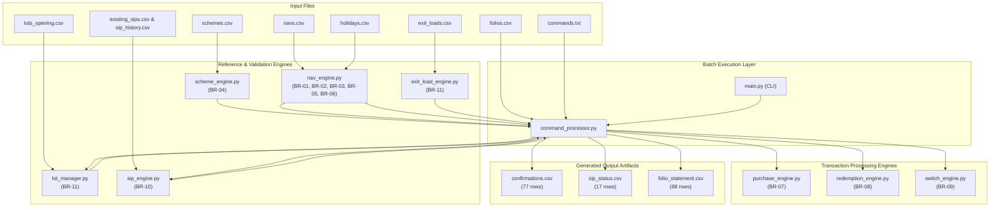

# Mutual Fund Order Processing System (T001-PS-008)

[](https://www.python.org/)
[]()
[]()
[]()

A high-precision, regulation-compliant Python batch order processing engine for Asset Management Companies (AMCs) and Mutual Fund registrars. The system automates end-to-end processing for lump-sum purchases, redemptions, scheme switches, and Systematic Investment Plans (SIPs) while strictly enforcing regulatory cut-off times, funds-realisation rules, multi-tier exit-load schedules, FIFO lot management, and statutory ELSS 3-year lock-in restrictions.

---

## 1. Problem Statement

Asset Management Companies (AMCs) process thousands of investor transactions daily across multiple scheme categories (Equity, Debt, Liquid). In production fund accounting, transaction execution is governed by stringent SEBI and AMFI regulations:

- **Cut-Off Rules:** Determining the applicable Net Asset Value (NAV) depends not only on the order placement timestamp but also on the funds realisation timestamp, with differing statutory cut-off times for Liquid funds (1:30 PM) versus Equity/Debt funds (3:00 PM).
- **Taxation & Charges:** Mandatory regulatory deductions such as 0.005% stamp duty on purchases and tiered exit loads on redemptions must be computed lot-by-lot without fractional penny errors.
- **Lot Management & Lock-in:** Units must be depleted strictly using First-In, First-Out (FIFO) ordering, and tax-saving funds (ELSS) must hold units in an inviolable 3-year statutory lock-in from their individual allotment dates.
- **SIP Lifecycle:** Systematic Investment Plans require resilient monthly scheduling with month-end clamping (e.g., February 31 $\implies$ February 28/29), market holiday rolling, consecutive debit failure tracking, auto-cancellation, and pause controls.

Manual or loosely coupled order processing introduces reconciliation mismatches, regulatory penalties, and investor financial loss.

---

## 2. Project Objectives

1. **Deterministic Regulatory Compliance:** Enforce business rules BR-01 through BR-11 with exact precision and zero floating-point rounding errors.
2. **High-Precision Financial Arithmetic:** Use `decimal.Decimal` throughout all monetary, unit, and exit-load calculations with strict rounding policies (`ROUND_DOWN` for unit allocation, `ROUND_CEILING` for amount-to-unit conversions).
3. **Comprehensive Order Support:** Handle lump-sum `PURCHASE`, multi-mode `REDEEM` (`ALL`, `UNITS`, `AMOUNT`), two-legged atomic `SWITCH`, and complete `SIP` lifecycles (`REGISTER`, `DEBIT_RESULT`, `PAUSE`).
4. **Resilient Data Ingestion:** Validate master data files (`schemes.csv`, `navs.csv`, `holidays.csv`) with fail-fast validation and clear row-numbered error reporting.
5. **Auditable Reporting:** Generate standardized CSV output artifacts: transaction confirmations (`confirmations.csv`), SIP lifecycle logs (`sip_status.csv`), and remaining lot statements (`folio_statement.csv`).

---

## 3. Key Features

- **Multi-Category Cut-Off Engine (BR-01, BR-02):** Automatic cut-off evaluation (Equity/Debt 3:00 PM, Liquid 1:30 PM) with funds-realisation time arbitration (`max(order_ts, funds_realised_ts)`).
- **Calendar & Holiday Progression (BR-03, BR-06):** Business-day resolution automatically rolling past weekends and gazetted market holidays loaded from `holidays.csv`.
- **Statutory Stamp Duty & Unit Allocation (BR-07):** 0.005% stamp duty deduction quantized to paise (`ROUND_HALF_UP`) and unit allotment strictly rounded **DOWN** to three decimal places (`ROUND_DOWN`).
- **Ceiling-Rounded Redemption & Exit Loads (BR-08, BR-11):** Amount-to-unit conversions rounded **UP** to three decimal places (`ROUND_CEILING`), with FIFO lot depletion and holding-day-based exit-load schedules.
- **ELSS 3-Year Lock-In Defense (BR-11):** Exact 3-year statutory lock-in calculation with leap-year handling (Feb 29 $\implies$ Feb 28); partial redemptions and `REDEEM ALL` touch only matured, unlocked units.
- **Atomic Two-Legged Switch Engine (BR-09):** Coordinates source redemption (`SWITCH_OUT`) and target purchase (`SWITCH_IN`) with dual confirmation records and target purchase minimum waiver.
- **Full SIP Lifecycle Management (BR-10):** Monthly cycle generation, month-end clamping (Feb 28/29), rolling forward past non-business days, 3-consecutive-failure auto-cancellation, failure reset on success, and annual pause limits.

---

## 4. Technology Stack

- **Core Language:** Python 3.10+ (tested on Python 3.10, 3.11, 3.12, 3.13, 3.14)
- **Runtime Dependencies:** Python Standard Library only (`decimal`, `dataclasses`, `datetime`, `csv`, `pathlib`, `enum`, `calendar`, `typing`)
- **Testing & Quality Assurance:** `pytest` (240 tests, 100% pass rate)

---

## 5. System Architecture

The project is structured as a modular, decoupled domain pipeline:



---

## 6. Project Directory Structure

```text
T001-PS-008/
├── .gitignore                      # Git ignore configuration
├── README.md                       # Comprehensive project documentation
├── requirements.txt                # Testing dependencies (pytest)
├── confirmations.csv               # Generated confirmation records (77 rows)
├── sip_status.csv                  # Generated SIP lifecycle records (17 rows)
├── folio_statement.csv             # Generated remaining lots statement (88 rows)
├── data/
│   ├── holidays.csv                # Legacy sample holiday file
│   ├── nav.csv                     # Legacy sample NAV file
│   └── sample_pack/                # Official benchmark dataset
│       ├── commands.txt            # 92 transaction commands
│       ├── existing_sips.csv       # Pre-existing active SIPs
│       ├── exit_loads.csv          # Tiered exit load schedules
│       ├── folios.csv              # 10 investor folios
│       ├── holidays.csv            # 6 market holidays
│       ├── lots_opening.csv        # 30 opening investment lots
│       ├── navs.csv                # 396 scheme NAV records
│       ├── README.md               # Official sample pack specifications
│       ├── schemes.csv             # 6 mutual fund schemes
│       └── sip_history.csv         # Historic SIP debit outcomes
├── docs/
│   ├── business_rules.md           # Business rule register and confirmed specifications
│   ├── class_diagram.md            # Domain class relationships
│   ├── day10_integration_audit.md  # Day 10 full-system audit report
│   ├── final_project_report.md     # Comprehensive academic capstone report
│   ├── glossary.md                 # BFSI domain definitions
│   ├── open_questions.md           # Mentor questions and clarifications
│   ├── project_overview.md         # Architecture overview
│   └── state_diagram.md            # Order and SIP lifecycle state transitions
├── src/
│   ├── __init__.py                 # Package initializer
│   ├── command_processor.py        # Central command dispatcher and batch runner
│   ├── exit_load_engine.py         # Exit-load schedule band parser and calculator
│   ├── lot_manager.py              # FIFO lot depletion, holdings, and ELSS lock-in
│   ├── main.py                     # Application CLI entry point
│   ├── models.py                   # Domain dataclasses and Enums
│   ├── nav_engine.py               # Cut-off times, business-day calendar, NAV loader
│   ├── purchase_engine.py          # Stamp duty and unit allocation logic
│   ├── redemption_engine.py        # Redemption amount calculation and payout dates
│   ├── scheme_engine.py            # Scheme master validation and loader
│   ├── sip_engine.py               # SIP registration, scheduling, pause, and debit tracking
│   └── switch_engine.py            # Atomic two-legged switch execution
└── tests/
    ├── test_command_processor.py   # Integration tests and planted edge cases (EC-01 to EC-08)
    ├── test_fifo_elss.py           # FIFO depletion, partial slices, leap-year ELSS tests
    ├── test_holidays.py            # Holiday parsing, duplicate dates, weekend rolling tests
    ├── test_models.py              # Dataclass initialization tests
    ├── test_nav.py                 # Cut-off time and business-day helper tests
    ├── test_purchase.py            # Purchase minimums, stamp duty, unit round-down tests
    ├── test_redemption.py          # Redemption modes, ceiling rounding, exit load tests
    ├── test_scheme.py              # Scheme schema validation, category binding tests
    ├── test_sip_engine.py          # SIP scheduling, failure counter, auto-cancellation tests
    └── test_switch.py              # Switch validation, dual confirmation, waiver tests
```

---

## 7. Business Rules (BR-01 to BR-11)

| Rule ID | Rule Title | Core Specification | Implementation Module |
|---|---|---|---|
| **BR-01** | **NAV Cut-Off Rules** | Equity & Debt: 3:00 PM (before = same day, at/after = next business day). Liquid: 1:30 PM (before = previous day, at/after = next business day). | `src/nav_engine.py` |
| **BR-02** | **Funds Realisation Rule** | Governing decision timestamp is $\max(\text{order\_ts}, \text{funds\_realised\_ts})$. Realisation time decides cut-off compliance. | `src/nav_engine.py` |
| **BR-03** | **Business-Day Calendar** | Business days are Monday through Friday, strictly excluding dates listed in `holidays.csv`. | `src/nav_engine.py` |
| **BR-04** | **Scheme Master Validation** | Validates uppercase alphanumeric scheme IDs, valid types, ELSS restricted to Equity, cut-off alignment, and strictly positive 2-decimal minimums. | `src/scheme_engine.py` |
| **BR-05** | **NAV File Validation** | Strict YYYY-MM-DD dates, exactly 4 decimal places, positive finite numbers, unique `(scheme_id, nav_date)` primary key. | `src/nav_engine.py` |
| **BR-06** | **Holiday Calendar Validation** | Validates ISO dates, rejects duplicates and impossible calendar days, safely handles weekend holidays, loops past consecutive holidays. | `src/nav_engine.py` |
| **BR-07** | **Purchase Order Processing** | First purchase min ₹5,000; additional min ₹1,000; 0.005% stamp duty quantized to paise; units strictly rounded **DOWN** to 3 decimal places. | `src/purchase_engine.py` |
| **BR-08** | **Redemption Order Processing** | Modes `ALL`, `UNITS`, `AMOUNT`; partial redemptions min ₹1,000; amount-to-units uses ceiling rounding to 3 decimal places; payout $T+1$ (Debt/Liquid) or $T+2$ (Equity). | `src/redemption_engine.py` |
| **BR-09** | **Scheme Switch Processing** | Atomic two-legged transaction (`SWITCH_OUT` + `SWITCH_IN`); 0.005% stamp duty on target leg; target purchase minimum waived; dual confirmation records. | `src/switch_engine.py` |
| **BR-10** | **SIP Engine** | Min ₹500; first installment $\ge$ 7 days; month-end clamping (Feb 28/29); 3 consecutive debit failures auto-cancels; success resets counter; pause 1-3 months once/year. | `src/sip_engine.py` |
| **BR-11** | **FIFO Lots & ELSS Lock-In** | Earliest allotment date depleted first; per-lot exit loads; 3-year statutory lock-in per lot for ELSS; locked lots untouched in `REDEEM ALL`. | `src/lot_manager.py` |

---

## 8. Input CSV File Formats

| File Name | Purpose | Primary Key | Key Columns |
|---|---|---|---|
| `schemes.csv` | Scheme master records (6 rows) | `scheme_id` | `scheme_id,scheme_name,scheme_type,elss,cutoff_time,min_first_purchase,min_additional,min_sip,min_redemption` |
| `navs.csv` | Historical NAV publications (396 rows) | `(scheme_id, nav_date)` | `nav_date,scheme_id,nav` (4 decimal places) |
| `holidays.csv` | Market & bank holidays (6 rows) | `date` | `date,holiday_name` |
| `exit_loads.csv` | Tiered exit load schedules (8 rows) | `(scheme_type, from_day, to_day)` | `scheme_type,from_day,to_day,load_pct` |
| `folios.csv` | Investor folio accounts (10 rows) | `folio_id` | `folio_id,investor_name,pan,mobile,bank_account,ifsc,opened_date` |
| `lots_opening.csv` | Opening portfolio holdings (30 rows) | `lot_id` | `lot_id,folio_id,scheme_id,allotment_date,units,purchase_nav` |
| `existing_sips.csv` | Pre-existing active SIPs (2 rows) | `sip_id` | `sip_id,folio_id,scheme_id,amount,sip_day,registered_date,status,consecutive_failures` |
| `sip_history.csv` | Pre-existing SIP debit history (3 rows) | `(sip_id, instalment_no)` | `sip_id,instalment_no,instalment_date,result,reason` |
| `commands.txt` | Transaction command queue (92 commands) | Line Order | `COMMAND_NAME\|arg1\|arg2\|...` |

---

## 9. Output CSV File Formats

### 1. `confirmations.csv` (77 data rows)
Emits one row per order (`PURCHASE`, `REDEMPTION`, `SIP_PURCHASE`) and two rows per `SWITCH` (`SWITCH_OUT` then `SWITCH_IN`).
- **Columns:** `order_id,folio_id,scheme_id,txn_type,decision,rule_ids,nav_date,nav,gross_amount,stamp_duty,units,exit_load,net_amount,payout_date`
- **Formatting:** Units to 3 decimals, NAV to 4 decimals, Currency to 2 decimals. Empty numerical/date fields for rejected orders.

### 2. `sip_status.csv` (17 data rows)
Emits one row per SIP lifecycle event (`SIP_REGISTER`, `SIP_PAUSE`, `SIP_DEBIT_RESULT`).
- **Columns:** `sip_id,event,instalment_no,scheduled_date,result,order_id,consecutive_failures,sip_status,rule_ids`

### 3. `folio_statement.csv` (88 data rows)
Emits one row per remaining non-zero lot per `PRINT_FOLIO` command.
- **Columns:** `folio_id,as_of_date,scheme_id,lot_id,allotment_date,units,lock_in_until`
- **Formatting:** `lock_in_until` is populated exclusively for ELSS lots (`YYYY-MM-DD`).

---

## 10. Installation & Environment Setup

### Prerequisites
- Python 3.10 or higher installed on your system.
- Git command-line tool.

### Setup Instructions

1. **Clone the Repository:**
   ```bash
   git clone https://github.com/Chethu7353/T001-PS-008.git
   cd T001-PS-008
   ```

2. **Create and Activate a Virtual Environment:**
   ```bash
   # Windows (PowerShell)
   python -m venv venv
   .\venv\Scripts\Activate.ps1

   # Linux / macOS
   python3 -m venv venv
   source venv/bin/activate
   ```

3. **Install Dependencies:**
   ```bash
   pip install -r requirements.txt
   ```

---

## 11. Application Execution

The system supports two execution paradigms: an **Interactive Terminal Application** (default) and a headless **Batch Execution** mode.

### 1. Interactive Terminal Mode (Default)
Launch the interactive, menu-driven CLI:

```bash
python -m src.main
```

The system displays the interactive menu:
```text
===============================================
       MUTUAL FUND ORDER PROCESSING SYSTEM
===============================================
1. Purchase Mutual Fund
2. Redeem Mutual Fund
3. Switch Mutual Fund
4. Register SIP
5. Pause SIP
6. Process SIP Debit Result
7. View Investor Folio
8. View Available Schemes
9. View Transaction History
10. Generate Reports
11. Run Batch Processing
12. Exit
===============================================
```

**Key Interactive Capabilities:**
- **Full Engine Integration:** Every transaction reuses official domain engines (`CommandProcessor`, `purchase_engine`, `redemption_engine`, `switch_engine`, `sip_engine`, `lot_manager`).
- **Session State Accumulation:** Multiple purchases, redemptions, and switches accumulate dynamically across the active session.
- **Persistence Across Restarts:** Interactive transactions are recorded to `data/interactive_commands.txt` and automatically replayed on subsequent startups.
- **Safe Batch Delegation:** Option 11 runs the official sample pack batch without mutating interactive session state.

### 2. Headless Batch Execution Mode
To process the official benchmark dataset (`data/sample_pack/`) directly:

```bash
python -m src.main --batch
```

### Expected Batch CLI Output:
```text
Mutual Fund Order Processing System - Batch Execution
Processed 92 commands: 86 accepted, 6 rejected.
Generated confirmations.csv (77 rows)
Generated sip_status.csv (17 rows)
Generated folio_statement.csv (88 rows)
```

Generated files (`confirmations.csv`, `sip_status.csv`, and `folio_statement.csv`) are written directly to the project root directory.

---

## 12. Test Execution & Verification

Run the complete automated test suite using `pytest`:

```bash
# Quiet mode
python -m pytest -q

# Detailed verbose mode
python -m pytest -v
```

### Test Suite Summary:
```text
tests/test_command_processor.py ........ (9 tests)
tests/test_fifo_elss.py .................. (18 tests)
tests/test_holidays.py ............................ (28 tests)
tests/test_interactive.py ............. (13 tests)
tests/test_models.py .... (4 tests)
tests/test_nav.py ...................... (22 tests)
tests/test_purchase.py ............... (15 tests)
tests/test_redemption.py .................... (20 tests)
tests/test_scheme.py .................................. (34 tests)
tests/test_sip_engine.py ........................ (24 tests)
tests/test_switch.py ................................................... (53 tests)

======================== 240 passed in 0.95s ========================
```

---

## 13. Official Acceptance Cases (EC-01 to EC-08)

All 8 benchmark edge cases planted in the official sample pack have been verified with exact field-level precision:

| Case | Description | Actual Verified Behavior | Result |
|---|---|---|:---:|
| **EC-01** | Funds realisation at 15:00:00 determines NAV cutoff | `ORD-0006`: received 14:59:59 realised 15:00:00 $\to$ next business day NAV `2026-01-20`. | **PASS** |
| **EC-02** | Weekend & Republic Day holiday NAV selection | `ORD-0013`: Friday 16:00:00 before Monday holiday $\to$ Tuesday NAV `2026-01-27`. | **PASS** |
| **EC-03** | Day 31 SIP registration preceding February | `SIP-N01`: clamps to Feb 28 (Sat) $\to$ Mon `2026-03-02`; next cycle `2026-03-31`. | **PASS** |
| **EC-04** | Day 365 vs Day 366 Equity exit load (1% vs 0%) | `ORD-0026`: 1% exit load = ₹124.62.<br>`ORD-0027`: 0% nil exit load = ₹0.00. | **PASS** |
| **EC-05** | Amount redemption ceil3 units exceeding balance | `ORD-0034`: needs 708.740 units against holding of 708.739 $\to$ `REJECTED` (BR-08). | **PASS** |
| **EC-06** | Switch source proceeds fall below target minimum | `ORD-0008`: net proceeds ₹994.95 ($< 1000$); purchase minimum waived $\to$ `ACCEPTED`. | **PASS** |
| **EC-07** | ELSS lot maturing on redemption date itself | `ORD-0033`: redeems mature LOT-021 (182.406 units); locked LOT-022 remains untouched. | **PASS** |
| **EC-08** | Consecutive failure reset on success | `SIP-E01`: 2 fail $\to$ 1 success $\to$ 2 fail: remains `ACTIVE` with count 2. | **PASS** |

---

## 14. Known Limitations

1. **Naive Timestamps:** Timestamps in `commands.txt` are assumed to be in Indian Standard Time (IST, UTC+05:30) without explicit timezone offsets.
2. **Unified Holiday Calendar:** A single holiday schedule is applied across all scheme categories, whereas real-world equity funds observe exchange holidays (NSE/BSE) and liquid/debt funds observe banking clearing holidays (RBI/RTGS).
3. **Sequential Batch Architecture:** Commands are processed deterministically in sequential file order within a single process, suitable for reconciliation batches rather than high-concurrency microsecond trading.

---

## 15. Future Scope

- **RESTful API & Event Streaming:** Expose order ingestion via FastAPI/gRPC and Kafka event queues.
- **Relational ACID Storage:** Integrate PostgreSQL with SQLAlchemy/SQLModel for transaction logging and audit trails.
- **Multi-Tenancy & Investor Portals:** Add multi-AMC tenant isolation, role-based access control (RBAC), and customer-facing statement dashboards.
- **Corporate Action Automation:** Automate dividend reinvestments, scheme mergers, and bonus unit allotments.

---

## 16. Author & Academic Context

- **Project:** T001-PS-008 — Mutual Fund Order Processing System
- **Domain:** BFSI — Asset Management & Fund Accounting
- **Repository:** [https://github.com/Chethu7353/T001-PS-008](https://github.com/Chethu7353/T001-PS-008)
- **Evaluation Status:** Complete, Verified, and Submission-Ready.
