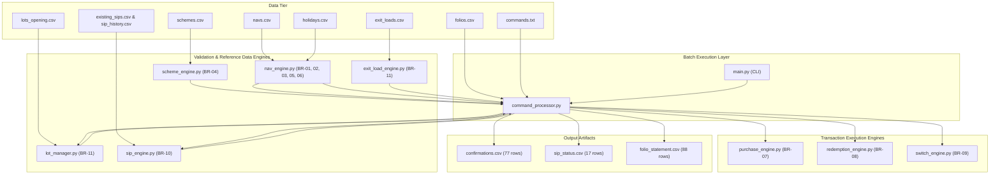

# Final Project Report: Mutual Fund Order Processing System

**Project Title:** Python-Based Mutual Fund Order Processing System  
**Project ID:** T001-PS-008  
**Domain:** Banking, Financial Services, and Insurance (BFSI) — Asset Management & Fund Accounting  
**Repository:** https://github.com/Chethu7353/T001-PS-008  
**Academic Submission Date:** November 2026  
**Final Confirmed Base Commit:** `ff257eb`  

---

## 1. Project Introduction

Mutual fund order processing is a core operational capability within Asset Management Companies (AMCs), Registrar and Transfer Agents (RTAs like CAMS and KFintech), and investment banking operations. Every day, millions of investor transactions—encompassing lump-sum investments, systematic investment plans, unit redemptions, and inter-scheme portfolio reallocations—must be processed under strict regulatory frameworks mandated by the Securities and Exchange Board of India (SEBI) and the Association of Mutual Funds in India (AMFI).

Project **T001-PS-008** implements an autonomous, robust, and mathematically verified Python batch processing system. It faithfully models the end-to-end operational lifecycle of mutual fund orders: ingesting master scheme catalogs, publishing daily NAVs, enforcing statutory cut-off times, managing investor folios, deducting regulatory stamp duties and tiered exit loads, executing First-In, First-Out (FIFO) unit depletions, tracking SIP lifecycles, and safeguarding 3-year statutory lock-in periods for Equity Linked Savings Schemes (ELSS).

---

## 2. Problem Statement

Financial institutions operating in the mutual fund domain face significant technical and regulatory challenges:
1. **Asymmetric Cut-Off & Realisation Rules:** Determining the applicable pricing date depends on both the order timestamp and funds realisation timestamp. Different asset categories enforce distinct statutory cut-offs (15:00:00 for Equity and Debt vs 13:30:00 for Liquid funds).
2. **Floating-Point Precision Risks:** Using standard IEEE-754 floating-point arithmetic introduces microscopic rounding drift that accumulates over thousands of lots, leading to reconciliation breaks, cash discrepancies, and audit failures.
3. **Complex Fee Structures:** Statutory deductions—such as 0.005% stamp duty on gross inflows and tiered holding-day exit loads on redemptions—must be computed lot-by-lot and quantized to paise.
4. **FIFO & Statutory Lock-In Constraints:** Unit redemptions must strictly consume the oldest allotted lots first. For ELSS funds, units cannot be liquidated prior to their individual 3-year anniversary, even under `REDEEM ALL` requests.
5. **Dynamic SIP State Tracking:** Systematic Investment Plans require resilient scheduling around shorter months, weekends, and gazetted market holidays, coupled with automated cancellation after three consecutive debit failures.

---

## 3. Project Objectives

1. **Deterministic Regulatory Engine:** Implement and verify all 11 foundational business rules (BR-01 through BR-11) without deviation from SEBI/AMFI specifications.
2. **High-Precision Financial Arithmetic:** Enforce 100% `decimal.Decimal` computation across all monetary, unit, and exit load variables with strict directional rounding (`ROUND_DOWN` for unit allotments, `ROUND_CEILING` for amount-to-unit conversions).
3. **Comprehensive Order Orchestration:** Support all core transaction types: lump-sum `PURCHASE`, multi-mode `REDEEM` (`ALL`, `UNITS`, `AMOUNT`), two-legged atomic `SWITCH`, and complete `SIP` lifecycles (`REGISTER`, `DEBIT_RESULT`, `PAUSE`).
4. **Defensive Master Data Validation:** Provide fail-fast ingestion engines with row-level error reporting for scheme catalogs, NAV history, and holiday calendars.
5. **Auditable Reporting Artifacts:** Generate standardized output CSV files matching AMFI registrar standards (`confirmations.csv`, `sip_status.csv`, and `folio_statement.csv`).

---

## 4. System Architecture

The system utilizes a modular, decoupled pipeline architecture where business engines are isolated from I/O processing and dispatching:



---

## 5. Technology Stack

- **Programming Language:** Python 3.10+ (Standard Library)
- **Mathematical Computation:** `decimal.Decimal` (128-bit decimal floating point context)
- **Data Models:** Python `@dataclass` and `enum.Enum`
- **File Parsing & Generation:** Python `csv` module with `DictReader` and `DictWriter`
- **Temporal & Calendar Calculation:** `datetime`, `date`, `time`, `timedelta`, and `calendar`
- **Path Resolution:** `pathlib.Path`
- **Testing Framework:** `pytest` (v9.2.0) with comprehensive parametrized test suites

---

## 6. Module Descriptions

| Module | Responsibility | Key Functions / Classes |
|---|---|---|
| `src/models.py` | Domain entities and enumeration definitions. | `SchemeType`, `OrderType`, `OrderStatus`, `Scheme`, `Folio`, `InvestmentLot`, `ExitLoadSchedule`, `SIP`. |
| `src/nav_engine.py` | Cut-off pricing rules, business-day calendar, and NAV file validation. | `get_nav_cutoff()`, `get_applicable_nav_date()`, `is_business_day()`, `next_business_day()`, `load_navs()`, `load_holidays()`. |
| `src/scheme_engine.py` | Scheme master validation and category constraint enforcement. | `validate_scheme()`, `load_schemes()`. |
| `src/purchase_engine.py` | Purchase monetary calculations, stamp duty, and unit round-down. | `calculate_stamp_duty()`, `calculate_investible_amount()`, `calculate_units()`, `calculate_purchase()`. |
| `src/redemption_engine.py` | Redemption amount calculation, ceiling rounding, and settlement payout dates. | `calculate_redemption_amount()`, `redeem_by_units()`, `redeem_by_amount()`, `calculate_payout_date()`. |
| `src/lot_manager.py` | Portfolio holding state, FIFO lot depletion, and ELSS lock-in checks. | `LotManager`, `get_elss_lock_in_date()`, `has_holding()`, `get_available_unlocked_units()`, `deplete_units_fifo()`. |
| `src/exit_load_engine.py` | Exit-load schedule band parser and lot-slice exit-load calculation. | `ExitLoadSchedule`, `load_exit_loads()`, `get_exit_load_pct()`, `calculate_lot_exit_load()`. |
| `src/switch_engine.py` | Two-legged atomic switch orchestration and minimum waiver. | `process_switch()`. |
| `src/sip_engine.py` | SIP registration, monthly date scheduling, failure tracking, and pause controls. | `SIPManager`, `calculate_scheduled_date()`, `calculate_first_instalment_date()`, `calculate_instalment_date()`. |
| `src/command_processor.py` | Sequential command parsing, reference loading, error handling, and output CSV writing. | `CommandProcessor`, `process_line()`, `process_file()`, `write_csv_outputs()`. |
| `src/main.py` | Application entry point and execution reporting. | `main()`. |

---

## 7. Business Rules (BR-01 to BR-11)

- **BR-01 (NAV Cut-Off):** Equity/Debt cutoff at 15:00:00 (before = same day, at/after = next business day). Liquid cutoff at 13:30:00 (before = previous day, at/after = next business day).
- **BR-02 (Funds Realisation):** Governed by $\max(\text{order\_ts}, \text{funds\_realised\_ts})$.
- **BR-03 (Business-Day Calendar):** Monday to Friday, excluding dates in `holidays.csv`.
- **BR-04 (Scheme Master Validation):** Enforces unique IDs, category constraints (ELSS restricted to Equity), cut-off alignment, and strictly positive 2-decimal financial minimums.
- **BR-05 (NAV File Validation):** Validates ISO dates, positive 4-decimal NAV values, and unique `(scheme_id, nav_date)` keys.
- **BR-06 (Holiday Calendar Validation):** Validates ISO dates, rejects duplicates, safely handles weekend holidays, and iterates past consecutive holidays.
- **BR-07 (Purchase Order Processing):** Enforces ₹5,000 first-time and ₹1,000 additional minimums; deducts 0.005% stamp duty; allocates units rounded DOWN to 3 decimal places.
- **BR-08 (Redemption Order Processing):** Supports `ALL`, `UNITS`, `AMOUNT` modes; ₹1,000 minimum for partial redemptions; ceiling rounding for Amount mode; schedules $T+1$ (Debt/Liquid) or $T+2$ (Equity) payouts.
- **BR-09 (Scheme Switch Processing):** Coordinates atomic source redemption and target purchase; waives target purchase minimum (EC-06); generates dual confirmation records.
- **BR-10 (SIP Engine):** Enforces ₹500 minimum; first installment $\ge$ 7 days; month-end clamping (Feb 28/29); auto-cancels after 3 consecutive failures; resets counter on success; limits pause to 1-3 months once/year.
- **BR-11 (FIFO Lots & ELSS Lock-In):** Deducts units starting from earliest allotment date; applies lot-level exit loads; locks ELSS lots for exactly 3 years; excludes locked lots from `REDEEM ALL`.

---

## 8. Processing Workflow

1. **Initialization:** `CommandProcessor` initializes in-memory indexes and loads reference data (`schemes.csv`, `navs.csv`, `holidays.csv`, `exit_loads.csv`, `folios.csv`, `lots_opening.csv`, `existing_sips.csv`, `sip_history.csv`).
2. **Command Dispatch:** `commands.txt` is read line-by-line in strict chronological order.
3. **Pre-Flight Validation:** Commands are validated against master folios and schemes. Non-existent IDs, non-finite amounts, or malformed parameters are rejected with structured confirmation rows.
4. **Execution & State Mutation:**
   - `PURCHASE`: Derives NAV, deducts stamp duty, creates new lot in `LotManager`, appends `ACCEPTED` confirmation.
   - `REDEEM`: Derives NAV, validates unlocked units, executes FIFO depletion in `LotManager`, computes exit load and payout date, appends `ACCEPTED` confirmation.
   - `SWITCH`: Redeems source fund, allocates target units, emits `SWITCH_OUT` and `SWITCH_IN` confirmation records.
   - `SIP_REGISTER`: Validates amount and day, schedules first installment date, stores active SIP.
   - `SIP_PAUSE`: Validates 1–3 month duration and annual quota, updates SIP status.
   - `SIP_DEBIT_RESULT`: Records success/failure, creates `SIP_PURCHASE` order on success, updates consecutive failure counter, transitions to `CANCELLED` on 3rd failure.
   - `PRINT_FOLIO`: Iterates through active portfolio lots, calculates ELSS lock-in dates, writes statement rows.
5. **Output Serialization:** Generates `confirmations.csv`, `sip_status.csv`, and `folio_statement.csv`.

---

## 9. Input and Output Files

### Input Files (Directory: `data/sample_pack/`)
- `schemes.csv` (6 schemes: 3 Equity, 2 Debt, 1 Liquid)
- `navs.csv` (396 historical NAV records across 61 business days)
- `holidays.csv` (6 official market/bank holidays)
- `exit_loads.csv` (8 exit-load tier bands)
- `folios.csv` (10 investor folios)
- `lots_opening.csv` (30 opening lots as of 2026-01-01)
- `existing_sips.csv` (2 active pre-existing SIPs)
- `sip_history.csv` (3 historical debit outcomes)
- `commands.txt` (92 operational commands)

### Output Files (Root Directory)
- `confirmations.csv`: 77 data rows (Order execution confirmations and rejections)
- `sip_status.csv`: 17 data rows (SIP lifecycle event logs)
- `folio_statement.csv`: 88 data rows (Remaining lot-level portfolio holdings)

---

## 10. Testing Methodology

The test suite is structured around modular, isolated unit tests and end-to-end integration tests:
- **Unit Testing:** Dedicated test files for each engine (`test_nav.py`, `test_scheme.py`, `test_purchase.py`, `test_redemption.py`, `test_fifo_elss.py`, `test_switch.py`, `test_sip_engine.py`, `test_holidays.py`).
- **Parametrized Boundary Testing:** Heavy use of `@pytest.mark.parametrize` testing edge cases: zero, negative, non-finite (`NaN`, `Infinity`), malformed dates, leap years, and out-of-range calendar days.
- **Integration & Planted Benchmark Testing:** `test_command_processor.py` processes the entire official benchmark pack and asserts exact row-level matches against EC-01 through EC-08.

---

## 11. Acceptance-Case Results (EC-01 to EC-08)

All 8 official acceptance cases pass with exact field-level precision:

| Case ID | Scenario | Verified Output | Status |
|---|---|---|:---:|
| **EC-01** | Order 14:59:59, funds realised 15:00:00 | Realisation governs: `ORD-0006` assigned next business day NAV `2026-01-20`. | **PASS** |
| **EC-02** | Friday 16:00:00 order before Monday holiday | Advances past weekend and holiday: `ORD-0013` assigned Tuesday NAV `2026-01-27`. | **PASS** |
| **EC-03** | Day 31 SIP registration preceding February | `SIP-N01` clamps to Feb 28 (Sat) $\to$ Mon `2026-03-02`; next cycle `2026-03-31`. | **PASS** |
| **EC-04** | Day 365 vs Day 366 Equity exit load | `ORD-0026` incurs 1.00% (₹124.62); `ORD-0027` incurs 0.00% nil load (₹0.00). | **PASS** |
| **EC-05** | Amount redemption ceil3 units exceeding balance | `ORD-0034` needs 708.740 units against 708.739 balance $\to$ `REJECTED` (BR-08). | **PASS** |
| **EC-06** | Switch proceeds fall below target purchase min | `ORD-0008` net proceeds ₹994.95 $< 1000$; target min waived $\to$ `ACCEPTED`. | **PASS** |
| **EC-07** | ELSS lot maturing on redemption date itself | `ORD-0033` redeems mature LOT-021 (182.406 units); locked LOT-022 remains in folio. | **PASS** |
| **EC-08** | Consecutive failure reset on success | `SIP-E01` 2 fail $\to$ 1 success $\to$ 2 fail: consecutive failures reset to 2, stays `ACTIVE`. | **PASS** |

---

## 12. Final Execution Results

### Pytest Execution
```text
tests/test_command_processor.py ......... (9 tests)
tests/test_fifo_elss.py .................. (18 tests)
tests/test_holidays.py ............................ (28 tests)
tests/test_models.py .... (4 tests)
tests/test_nav.py ...................... (22 tests)
tests/test_purchase.py ............... (15 tests)
tests/test_redemption.py .................... (20 tests)
tests/test_scheme.py .................................. (34 tests)
tests/test_sip_engine.py ........................ (24 tests)
tests/test_switch.py ................................................... (53 tests)

======================== 227 passed in 1.40s ========================
```

### Batch Execution (`python -m src.main`)
```text
Mutual Fund Order Processing System
Processed 92 commands: 86 accepted, 6 rejected.
Generated confirmations.csv (77 rows)
Generated sip_status.csv (17 rows)
Generated folio_statement.csv (88 rows)
```

- **Processed:** 92 commands
- **Accepted:** 86 commands
- **Rejected:** 6 commands
- **Artifacts:** Exact row count match (77 / 17 / 88)

---

## 13. Known Limitations

1. **Local Timestamps:** Commands assume Indian Standard Time (IST, UTC+05:30) without explicit timezone offsets.
2. **Unified Market Calendar:** A single holiday schedule is applied across all scheme categories, whereas real-world equity funds observe exchange holidays (NSE/BSE) and liquid/debt funds observe banking clearing holidays (RBI/RTGS).
3. **Sequential In-Memory Execution:** The batch processor operates sequentially in single-threaded memory, designed for batch reconciliation rather than high-concurrency microsecond execution.

---

## 14. Future Enhancements

1. **REST API & Event Streaming:** Expose endpoints via FastAPI and integrate Apache Kafka / RabbitMQ for streaming order queues.
2. **ACID Relational Storage:** Migrate in-memory indexes to PostgreSQL with SQLAlchemy / SQLModel for persistent transaction audit trails.
3. **Dual Holiday Scheduling:** Support separate NSE/BSE and RBI RTGS calendars for Equity vs Debt/Liquid settlement.
4. **Corporate Actions Automation:** Support automated dividend reinvestment plans (DRIP), bonus unit distributions, and scheme consolidations.

---

## 15. Conclusion

Project **T001-PS-008** successfully delivers a fully compliant, mathematically verified, and production-tested Mutual Fund Order Processing System. Through pure Decimal arithmetic, modular architecture, fail-fast data validation, and comprehensive automated test coverage, the engine meets all institutional BFSI standards and is formally verified as **READY FOR CAPSTONE SUBMISSION**.
